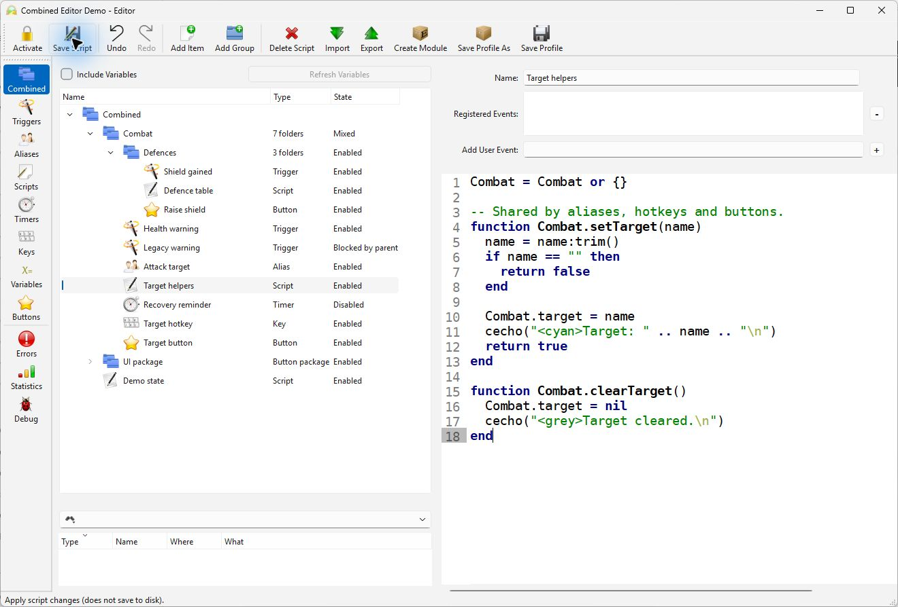
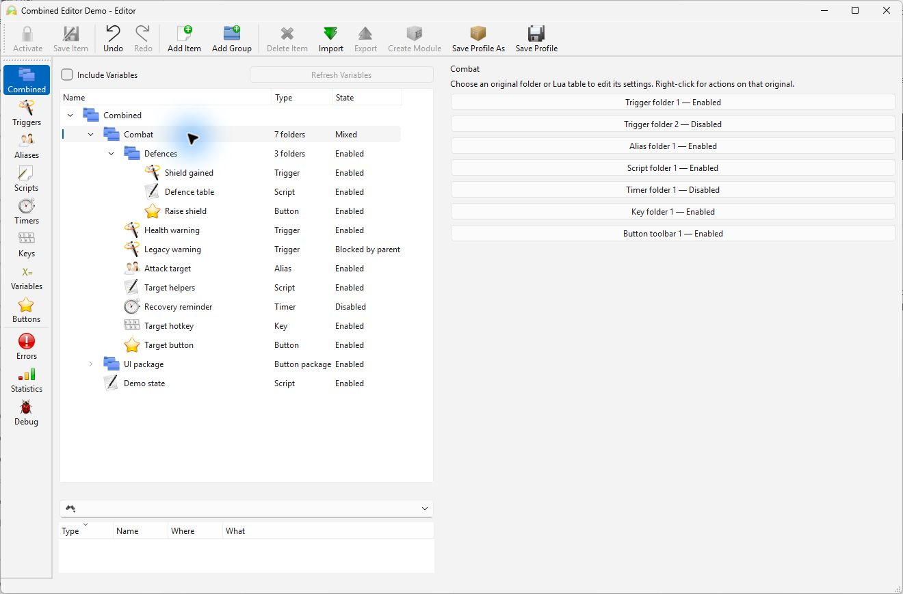

<h1 align="center">
   
  
   
  Mudlet
   
</h1>

<h4 align="center">Play immersive, multiplayer, pure-text RPGs on Mudlet.</h4>

## Combined editor — development fork

Work with **triggers, aliases, scripts, timers, keys, and buttons in one tree**.
The Combined view brings related items together while keeping each original
folder's ownership, settings, and execution behavior intact.

This is [sgeorge-robert's development fork](https://github.com/sgeorge-robert/Mudlet)
of [Mudlet](https://github.com/Mudlet/Mudlet). The feature is available on
[`codex/combined-editor-view`](https://github.com/sgeorge-robert/Mudlet/tree/codex/combined-editor-view),
the fork's default branch. **It is under development; there is no fork release yet.**

**Development of this fork is assisted by OpenAI Codex**, including implementation,
tests, and documentation. Samuel George directs the work and manually tests builds.
See [AI-assisted development](FORK.md#ai-assisted-development) for scope and attribution.

*One tree, familiar editors. The offline demo shows folders first, type icons,
and the difference between an item being disabled and being blocked by its parent.*

- **Browse related automation together.** Matching folder names merge for display,
  folders come first, and icons identify each item type.
- **Keep control of the originals.** Open an item's usual editor, or choose the
  original folder whose code, settings, and actions you want to use.
- **Include live Lua state when useful.** The optional **Include Variables** setting
  adds variables and tables; it is off by default and remembered per profile.
- **Return to a familiar view at any time.** The regular category views remain
  available from the editor toolbar.

  
See how matching folders keep their original settings

Here, seven originals appear as one **Combat** row. Both trigger folders remain
individually accessible, with their own enabled states. Selecting a choice opens
that original's settings; right-clicking gives actions for that original.

These are real captures from a Windows development build using synthetic offline
data. See the [screenshot notes](docs/images/combined-editor/README.md) for provenance.

Read the [Combined editor guide](docs/combined-editor-view.md) for usage and current
limits, or the [fork notes](FORK.md) for implementation scope and validation.
To try it, build this branch using the [build instructions](docs/platform-builds.md),
open the editor, and select **Combined**. Official upstream downloads do not
include this fork's additions.

## Upstream Mudlet

The project badges, community links, screenshots, and official downloads below
refer to upstream Mudlet. Its credits and license remain unchanged.

  
  
  
  
  

  <a href="#about">About</a> •
  <a href="#key-features">Key Features</a> •
  <a href="#download">Download</a> •
  <a href="#how-to-use">How To Use</a> •
  <a href="#roadmap">Roadmap</a> •
  <a href="#credits">Credits</a> •
  <a href="#license">License</a>

  

## About

Mudlet is a quality [MUD](https://en.wikipedia.org/wiki/Multi-user_dungeon) client, designed to take mudding to a new level.

It’s a modern breed of a client on the gaming scene – with an intuitive user interface, a specially designed scripting framework, and a very fast text display. That, along with cross-platform capability and an open-source development model result in a very likable game client.

## Key Features

* Simple to use
* Very, very fast
* Active development
* Big, thriving community
* Powerful trigger engine
* Rich Lua-based coding functionality (API)
* Excellent script editor
* 2D and 3D mapper with autowalk
* Powerful and simple to use GMCP
* Discord integration
* Completely themable
* Open-source and Free
* Cross platform: runs on Windows, macOS and Linux
* Full compatibility: run same scripts on any of the above

  
Explain?

### Easy to use client

We’re big on usability, and as such, creating an easy to use client and interface is one of the defining goals of the project. This applies to both the power users and usual gamers – everyone will feel at home with Mudlet, without having to waste too much time figuring out how to do something.

### Designed for speed

Mudlet is designed and built to be very fast and efficient right from the start. Its scripting engine is designed to scale to large systems without bogging down – and the text display is designed to handle thousands of lines in under a second. All in all, we are very serious about Mudlet being quick – and take all measures to make it so.

### Powerful Scripting

Mudlet features a scripting framework using [Lua](https://www.lua.org/) – a small, fast and efficient scripting language. This allows Mudlet to leverage the existing community and large ecosystem of existing packages for Lua without the many drawbacks of creating a Mudlet specific scripting language. Best of all, the Lua API is seamlessly integrated in Mudlet and shared by all aliases, triggers, scripts, keybindings, buttons and other Mudlet components.

### Cross-Platform love

We believe in making Mudlet available to people on all major platforms, and we work on keeping cross-platform compatibility right from start. Mudlet is available on Linux (both 32bit and 64bit), Windows, and macOS; you may be able to run it on additional platforms as well.

## Download

Download for free from [mudlet.org](https://www.mudlet.org/download/).

## How To Use

1. Download and double-click on Mudlet to run
1. Pick an existing game and hit `Connect`
1. ... or play one of your choosing:
    1. Click `New`
    1. Enter `Server address` and `Port` of your game (found on the game's website, e.g. `mygame.com` and `2003`)
    1. Pick a `Profile name`
    1. Hit `Connect`

## Compiling

If you'd like to compile Mudlet yourself instead of [downloading](https://www.mudlet.org/download/), you can find instructions to do so [here](https://wiki.mudlet.org/w/Compiling_Mudlet).

## Vision

Mudlet's [vision](https://www.mudlet.org/about/vision/) is to build the best text gaming experience possible to nurture & grow this niche scene.

## Roadmap

See the [project's roadmap](https://www.mudlet.org/2019/09/mudlet-5-roadmap-focus-on-first-time-player-experience/) to get an idea of where it's headed

## Contribute

Join in, contributions are welcome! Find out how you can start [Contributing](docs/CONTRIBUTING.md).

## Credits

Author: [Mudlet Makers](https://github.com/Mudlet/Mudlet/graphs/contributors). 

This software wouldnt've been possible without these open source packages:

- [Qt](https://www.qt.io/)
- [Lua](https://www.lua.org/)
- [PCRE](https://www.pcre.org/)
- [edbee](http://www.edbee.net/)
- [DBLSQD](https://www.dblsqd.com/)
- [argparse](https://github.com/luarocks/argparse)
- [Boost Graph Library](https://www.boost.org/doc/libs/1_83_0/libs/graph/doc/)
- [Busted](https://lunarmodules.github.io/busted/)
- [Ccache](https://ccache.dev/)
- [Communi](https://communi.github.io/)
- [Hunspell](https://hunspell.github.io/)
- [lua-http](https://daurnimator.github.io/lua-http/)
- [lua-yajl](https://github.com/brimworks/lua-yajl)
- [lua-zip](https://github.com/brimworks/lua-zip)
- [LuaFileSystem](http://keplerproject.github.io/luafilesystem/)
- [Luarocks](https://luarocks.org/)
- [LuaSQL](http://keplerproject.github.io/luasql/)
- [luautf8](https://github.com/starwing/luautf8)
- [pugixml](https://pugixml.org/)
- [SQLite](https://sqlite.org/index.html)
- [yajl](http://lloyd.github.io/yajl/)

Credit to [Markdownify](https://github.com/amitmerchant1990/electron-markdownify) for the README inspiration.

Windows code signing provided by [SignPath.io](https://about.signpath.io), certificate by [SignPath Foundation](https://signpath.org).

## License

GPL2+

---

> [website](https://www.mudlet.org/) &nbsp;&middot;&nbsp;
> [forums](https://forums.mudlet.org/) &nbsp;&middot;&nbsp;
> [manual](https://wiki.mudlet.org/w/Manual:Contents)

